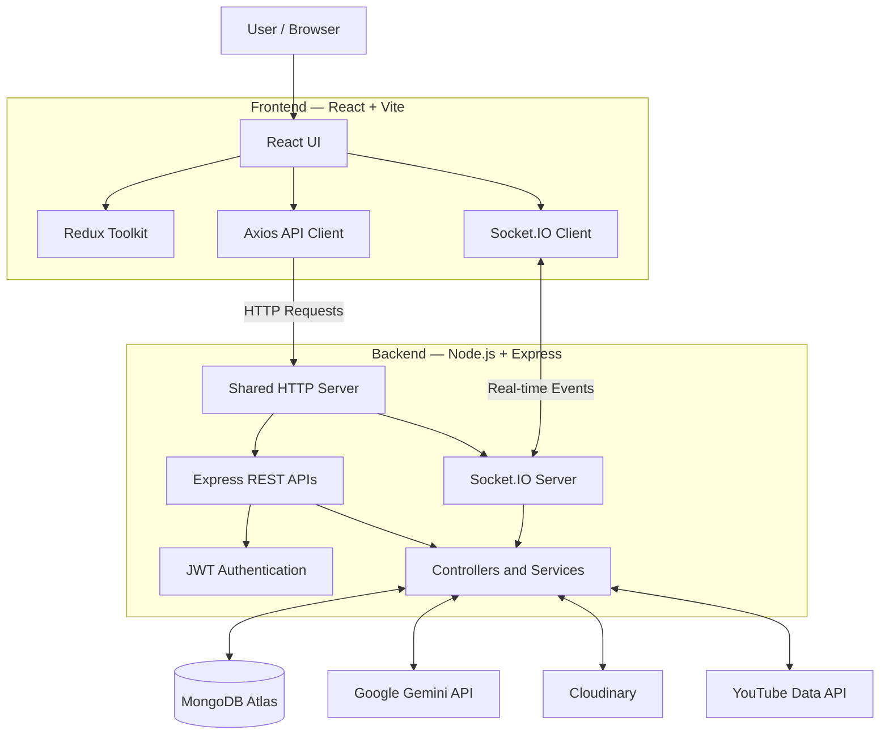

# 🏗️ AI Fitness Coach — System Architecture

## Architecture Overview

The application follows a full-stack client-server architecture. The React frontend communicates with the Node.js and Express backend through REST APIs and Socket.IO. Both REST APIs and Socket.IO share the same HTTP server.

## System Architecture

## Technology Components

| Layer | Technology | Responsibility |
|---|---|---|
| Frontend | React, Vite | User interface |
| State Management | Redux Toolkit | Application state |
| API Communication | Axios | REST API requests |
| Backend | Node.js, Express | Business logic and APIs |
| Authentication | JWT | Secure authentication |
| Real-Time | Socket.IO | Messaging and live events |
| Database | MongoDB, Mongoose | Persistent data |
| AI | Google Gemini | AI fitness coaching |
| Media | Cloudinary | Image and media storage |
| Videos | YouTube Data API | Fitness video discovery |

## Communication Flow

1. Users interact with the React frontend.
2. Axios sends HTTP requests to the Express backend.
3. JWT middleware handles protected API requests.
4. Socket.IO provides real-time communication through the shared HTTP server.
5. Backend services communicate with MongoDB and external integrations.
6. Responses are returned to the frontend and displayed to users.

## Server Startup Flow

1. Connect to MongoDB.
2. Initialize the Express application.
3. Create the HTTP server.
4. Attach Socket.IO to the HTTP server.
5. Start listening on the configured port.

**Entry point:** `server/src/index.js`